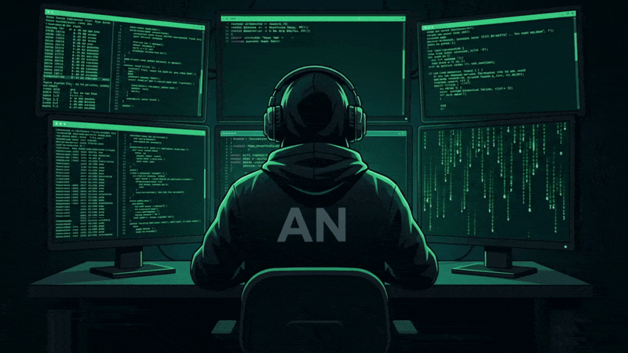

<table>
  <tr>
    <td valign="middle">
      <h1>Hi, I'm Syed Abdulla Nawaz</h1>
      <h3>Cybersecurity | Cloud Security | IoT Security | Blockchain Tech | Security Engineering</h3>
      

        
        
      

    </td>
    <td align="right" valign="middle">
      
    </td>
  </tr>
</table>

## About Me

I'm a Computer Science Engineering student at **Maharaja Institute of Technology, Mysuru**, specializing in **IoT, Cybersecurity, and Blockchain Technology**. I enjoy building practical security tools that connect cloud security, threat detection, network analysis, and automation.

-  Interested in **cybersecurity, cloud security, threat detection, and digital forensics**
-  Building security-focused projects with **Python, AWS, Docker, and FastAPI**
-  Exploring security frameworks including **MITRE ATT&CK** and **CIS Benchmarks**
-  Learning by building, testing, documenting, and improving hands-on projects
-  B.E. expected graduation: **August 2027**
-  Reach me at **[abdullanawaz17@gmail.com](mailto:abdullanawaz17@gmail.com)**

## Technical Skills

### Security & Networking

### Languages, Platforms & Tools

### Security Tooling

## GitHub Overview

<!-- GitHub profile statistics: includes stars earned, commits, PRs, issues and contributions -->

<!-- Public repository count -->

  
  

   Connect With Me

  
  &nbsp;&nbsp;
  
  &nbsp;&nbsp;
  
  &nbsp;&nbsp;
  

